# Distribox

<div align="center">
  
</div>

Distribox is a self-hosted platform for creating, managing and sharing virtual machines from a web interface.

<div align="center">
  <a href="https://youtu.be/eH6qJUTcxvI" target="_blank">
    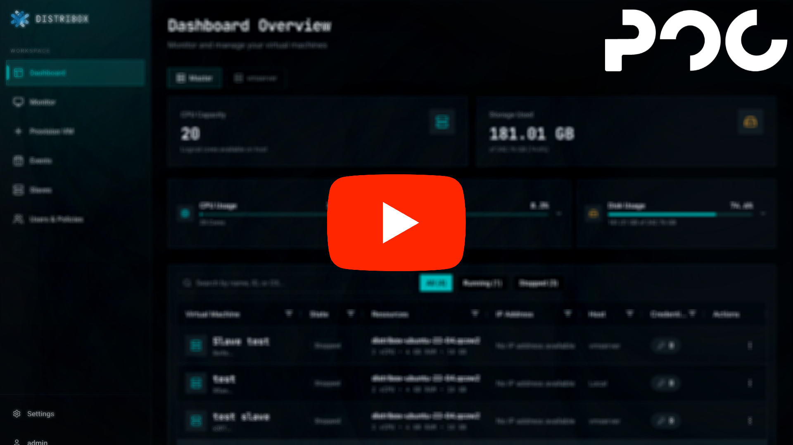
  </a>
</div>

## Features

### Create and manage VMs

Pick an operating system, CPU cores, RAM and disk size. From the dashboard you can then start, stop, restart, duplicate, rename or delete the VM, and open it in your browser.

<div align="center">
  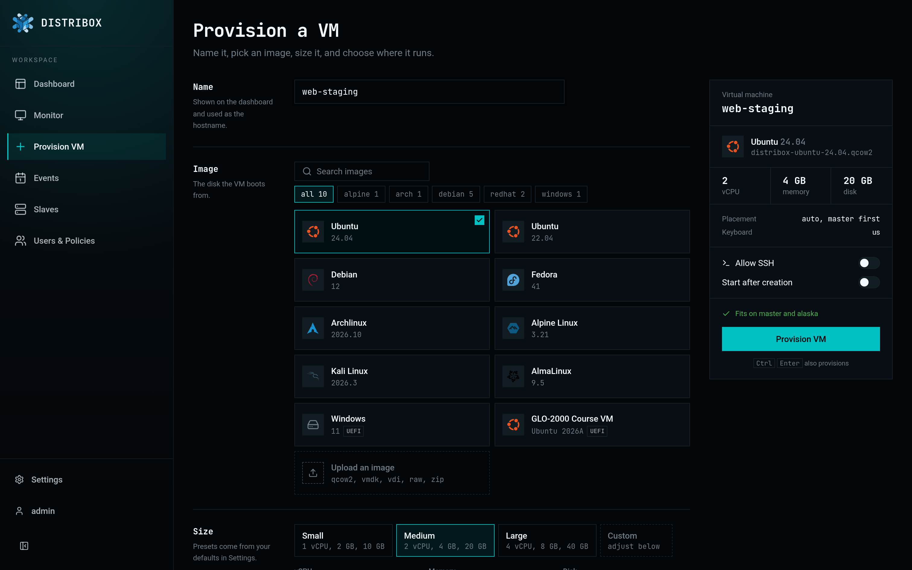
</div>

### Desktop in the browser

VM desktops stream to the browser through [gliss](https://github.com/lg-epitech/gliss), so there is nothing to install on the client. You can turn on the VM's sound from the desktop toolbar, and your text clipboard is shared with the VM in both directions.

<div align="center">
  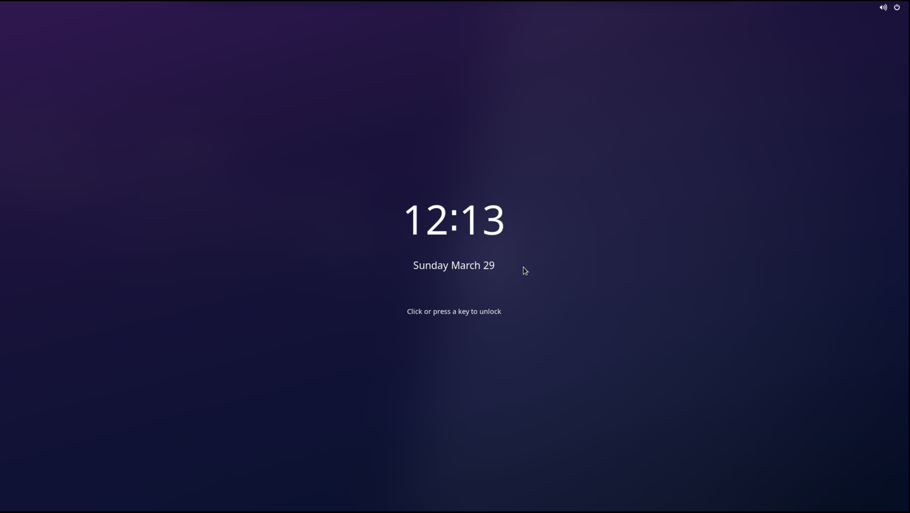
</div>

The [desktop guide](docs/desktop.md) covers what guests and browsers need for sound, the clipboard and keyboard layouts.

### Share a VM

Create a credential in a VM's **Access** tab and give it to whoever needs the machine. They paste it on the home page and get that desktop without an account. Revoke the credential to block new connections.

### SSH

Turn on **Allow SSH** for a VM or an event, and credential holders get an **SSH** button with a command to copy:

```bash
ssh -p 2222 <credential-id>@distribox.example.com
```

The gateway handles terminals, remote commands, SFTP and `scp`, and reaches only the VM tied to that credential. It is off by default. See the [SSH guide](docs/ssh.md) to set it up.

### Users and policies

Each user is given policies for the actions they may take, such as creating VMs, managing users, connecting to VMs or viewing metrics. Without the policy, the feature is hidden and access is denied. Admins have full access.

<div align="center">
  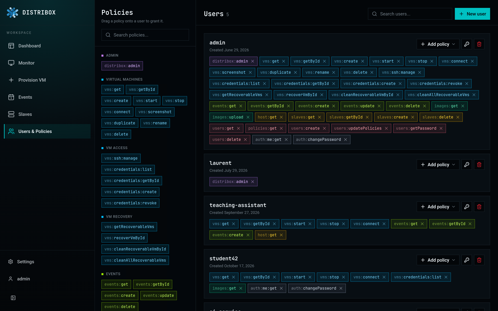
</div>

### Images

Ubuntu 22.04, Debian 12, Fedora 43, CentOS 10, AlmaLinux 9, Alpine Linux 3.21 and Arch Linux work out of the box. Their images sit in a remote registry. The backend downloads one the first time a VM needs it, caches it and picks up new revisions on its own.

To use your own image, click **Upload** in the image picker and choose a qcow2, VMDK, VDI or raw disk, or a zip archive holding one. Tick the UEFI option for machines exported from VirtualBox or VMware with EFI enabled.

### Multiple hosts

Other machines can join as slave nodes. The master sends each new VM to the node with the most free memory, unless you pick one yourself. The **Slaves** page has a guided tutorial for registering a node.

<div align="center">
  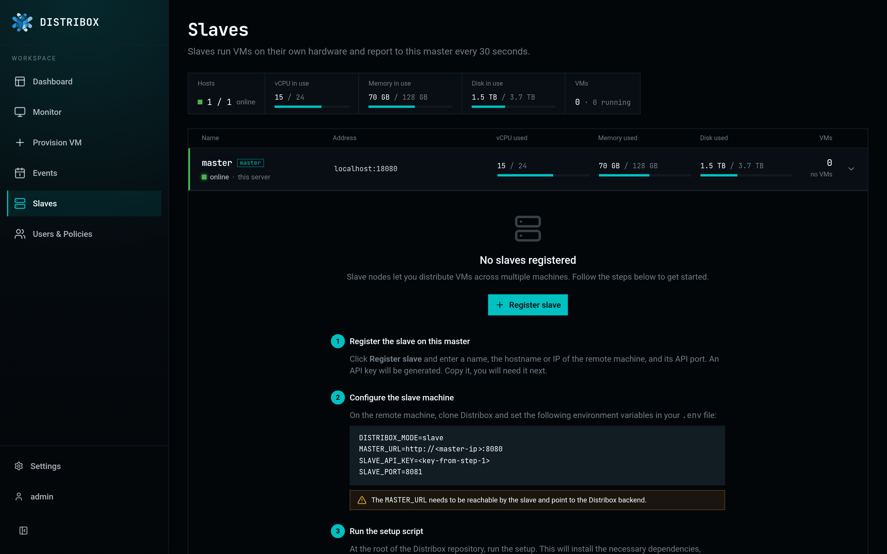
</div>

Connected nodes report their status and resource usage in real time.

<div align="center">
  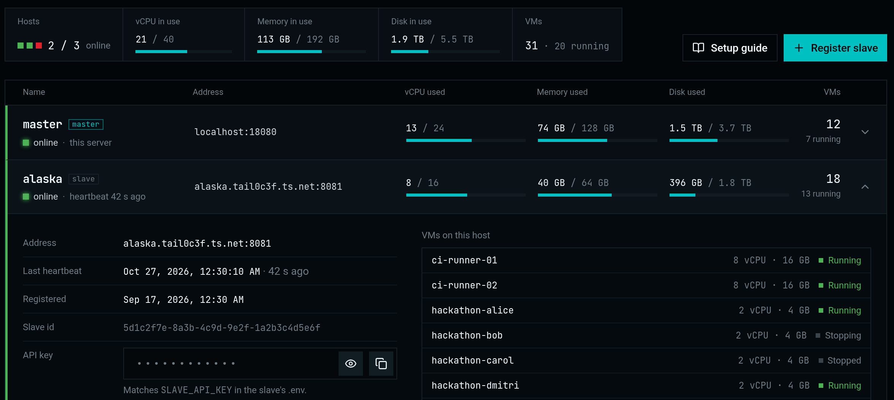
</div>

### Host metrics

The dashboard shows CPU, memory and disk usage for the master, for each slave or for the whole cluster.

<div align="center">
  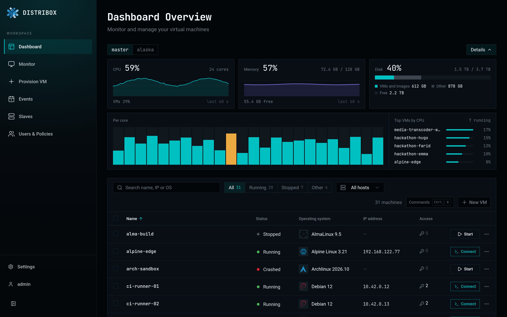
</div>

### Monitor

The monitor shows periodic screenshots of every VM on the instance. Click a running VM to connect to it.

<div align="center">
  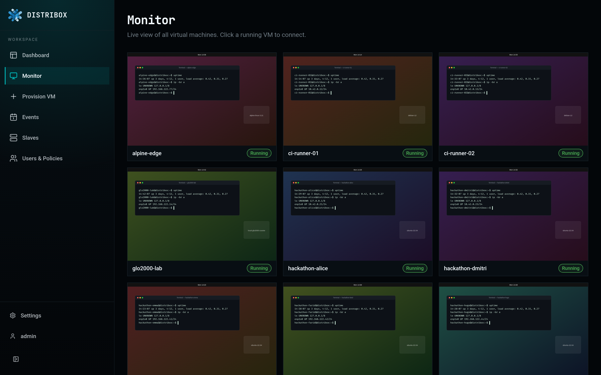
</div>

### Events

An event hands out VMs with the same spec to a limited number of participants until a deadline. Choose the OS, the resources, the participant limit and the deadline, and Distribox generates a link participants use to claim their VM.

<div align="center">
  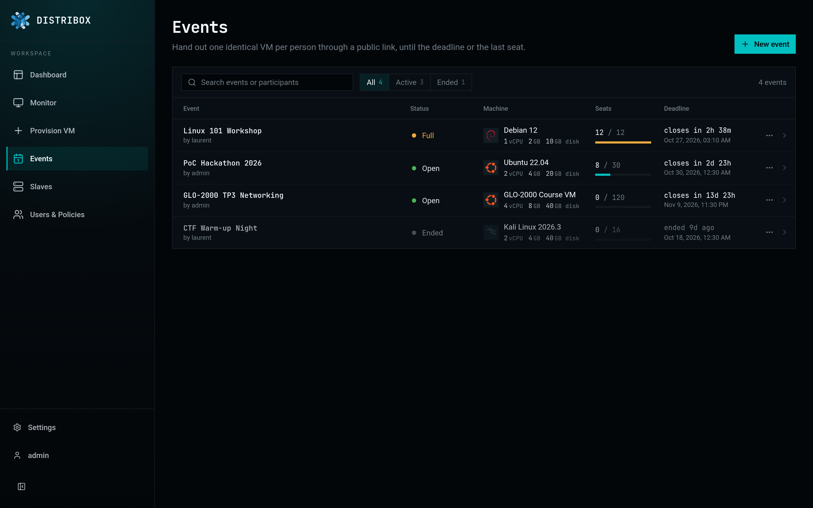
</div>

Each event page shows its details, its VMs with live previews and its participants.

<div align="center">
  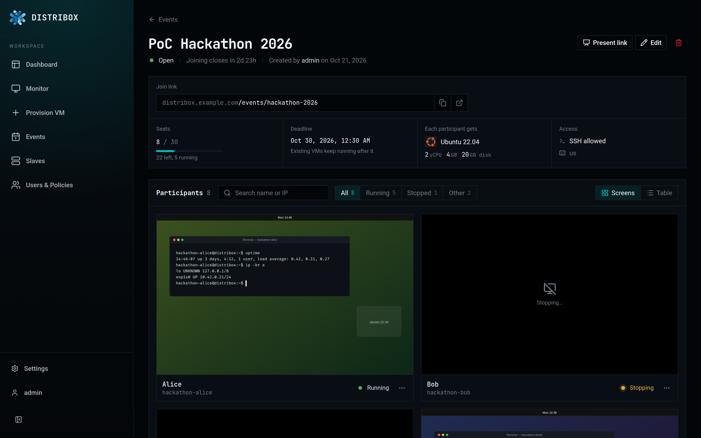
</div>

The share link can be previewed and copied from the dashboard.

<div align="center">
  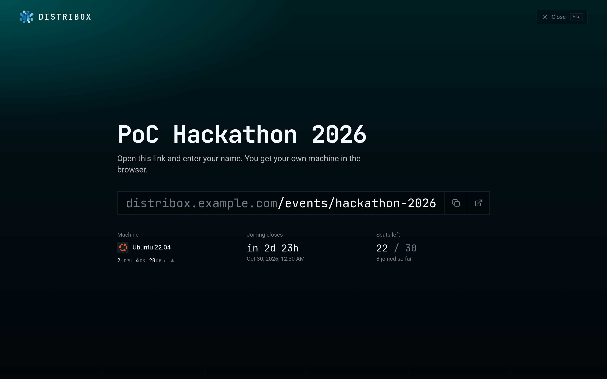
</div>

At the deadline, the link stops working, the VM credentials are revoked and the event's VMs are stopped. A past event can be [run again](docs/lab-configurations.md) with the same setup.

## Quickstart

You need an x86_64 Linux host with Docker Engine and the Compose plugin.

```bash
bash setup.sh

cp .env.example .env

docker compose --profile master up -d --build
```

Distribox is then available at `localhost:3000`.

`setup.sh` installs libvirt and the other host dependencies. Run it as your regular user, then log out and back in so the new group memberships apply. `bash setup.sh --dry-run` shows what it would change, and `--help` lists its options. On SELinux hosts, image-storage labels and backend access to the libvirt socket are left to you.

To keep VM disks on another partition, [set up storage](docs/storage.md) after `setup.sh` and before starting Compose.

For development with hot reloading:

```bash
docker compose --profile dev up --build
```

To add a slave node on another machine, follow the guide on the dashboard's **Slaves** page.

## Configuration

Settings live in `.env`, and [`.env.example`](.env.example) documents each one. Before the first start, change `ADMIN_PASSWORD` and set `DISTRIBOX_SECRET` to a long random value (`openssl rand -hex 32`). Changing the secret later makes stored credentials unreadable.

`VITE_*` values are baked into the frontend at build time, so rebuild it after changing one with `docker compose --profile master up -d --build frontend`. For other settings, recreate the backend with `docker compose up -d backend`. `docker compose restart` keeps the old environment.

## Deployment

### Reverse proxy and HTTPS

In production, put nginx in front of Distribox. The provided [`nginx.conf`](nginx.conf) listens on port 80, proxies `/api` to the backend on port 8080 and sends everything else to the frontend on port 3000.

```bash
sudo cp nginx.conf /etc/nginx/sites-available/distribox
sudo ln -s /etc/nginx/sites-available/distribox /etc/nginx/sites-enabled/
sudo nginx -t && sudo systemctl reload nginx
```

Serve it over HTTPS, because browsers only share the clipboard in a secure context. [Certbot](https://certbot.eff.org/) adds the certificate and the redirect to the nginx configuration:

```bash
sudo apt install certbot python3-certbot-nginx
sudo certbot --nginx -d your-domain.com
```

Then point `.env` at the proxy and rebuild with `docker compose --profile master up -d --build`:

```env
VITE_API_DOMAIN=https://your-domain.com/api
FRONTEND_URL=https://your-domain.com
ROOT_PATH=/api
```

### Firewall

The VMs' VNC servers listen on host ports 5900-5999 and must not be reachable from the network. Streaming goes through the backend's authenticated tunnel. Keep `VNC_LISTEN` and `VNC_HOST` on loopback, on slave nodes too, and block the range:

```bash
# ufw
sudo ufw deny 5900:5999/tcp

# or iptables
sudo iptables -A INPUT -p tcp --dport 5900:5999 -j DROP
```

## Documentation

- [Desktop streaming](docs/desktop.md): sound, clipboard, keyboard layouts and stream settings
- [SSH gateway](docs/ssh.md)
- [VM data on another partition](docs/storage.md)
- [Lab configurations](docs/lab-configurations.md): repeat a past event
- [Desktop profiling](docs/performance-profiling.md)
- [Images](images/README.md): build and customize OS images
- [Atlas](atlas/README.md): upload images to the Distribox registry
- [Backend](backend/README.md) and [frontend](frontend/README.md): run them outside Compose

## Contributing

See the [contributing guide](CONTRIBUTING.md).

## Our PoC team ❤️

Developers
| [<br><sub>Loan Riyanto</sub>](https://github.com/skl1017)
| :---: |

### Manager
| [<br><sub>Laurent Gonzalez</sub>](https://github.com/lg-epitech) |
| :---: |

<h2 align=center>
Organization
</h2>

<p align='center'>
    <a href="https://www.linkedin.com/company/pocinnovation/mycompany/">
        
    </a>
    <a href="https://www.instagram.com/pocinnovation/">
        
    </a>
    <a href="https://twitter.com/PoCInnovation">
        
    </a>
    <a href="https://discord.com/invite/Yqq2ADGDS7">
        
    </a>
</p>
<p align=center>
    <a href="https://www.poc-innovation.fr/">
        
    </a>
</p>

> 🚀 Don't hesitate to follow us on our different networks, and put a star 🌟 on `PoC's` repositories

> Made with ❤️ by PoC
