# Distribox

<div align="center">
  
</div>

Distribox is a self-hosted platform for creating, managing, and sharing virtual machines through a simple web interface.

<div align="center">
  <a href="https://youtu.be/eH6qJUTcxvI" target="_blank">
    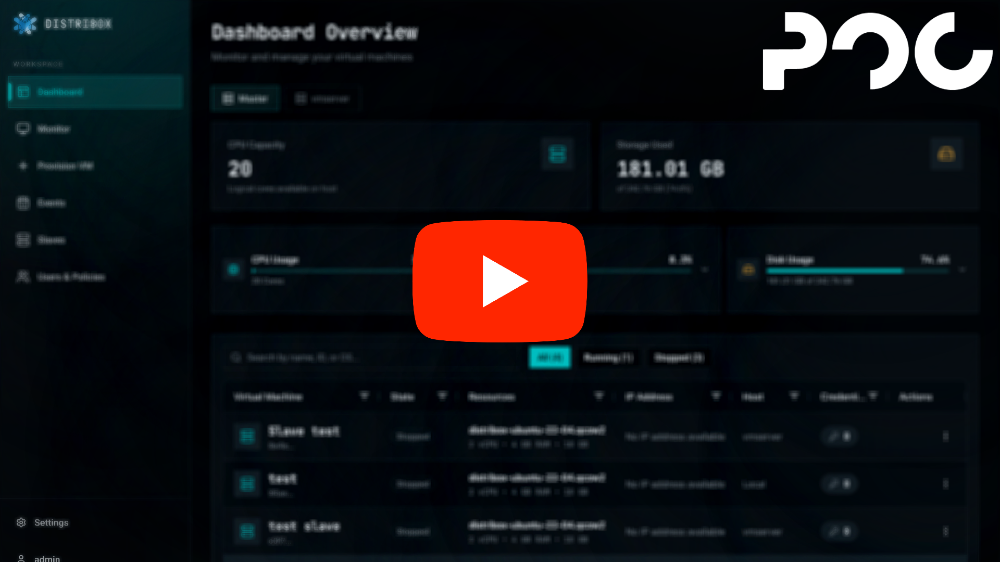
  </a>
</div>

## Features

---

## VM Creation and Management
Create virtual machines with custom specs: CPU cores, RAM, disk size, and operating system. Control VMs with start, stop, restart, duplicate, rename, and delete. Connect to any VM directly from your browser.

<div align="center">
  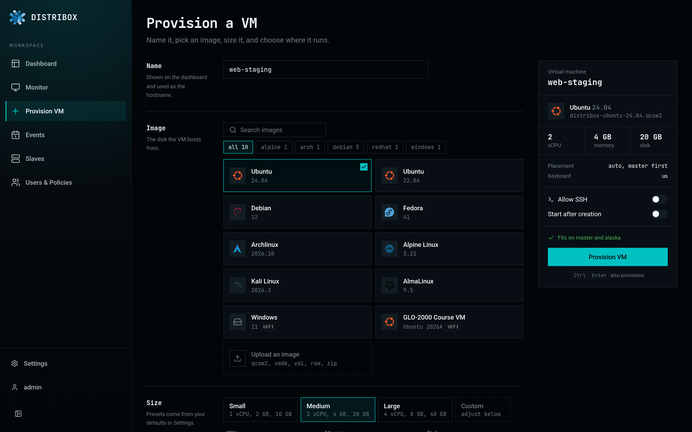
</div>

---

## Graphical VM Streaming
Distribox uses [gliss](https://github.com/lg-epitech/gliss) to stream VM desktops over WebSocket. For each connection, the backend on the VM's host starts a gliss server on its VNC display. Slave hosts send encoded video through their authenticated API to the master, which relays it to the browser. gliss is installed with the backend's Python dependencies. No client-side software required.

Enable VM audio with **Enable sound** in the desktop toolbar. Audio shares the authenticated desktop connection and stays off until requested. Existing VMs need a full shutdown and start to add the sound device; see [VM sound](images/README.md#vm-sound).

<div align="center">
  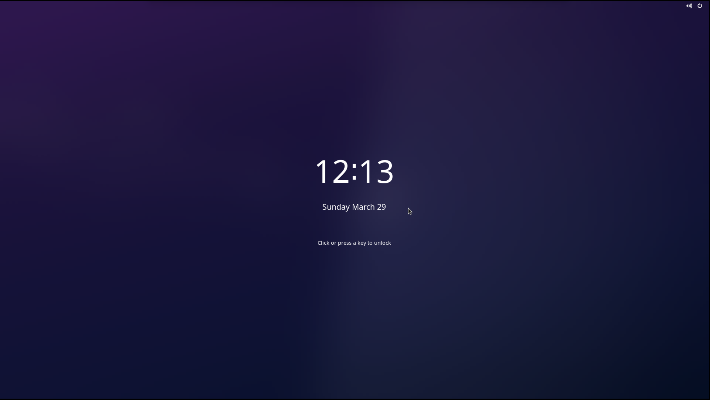
</div>

### Shared text clipboard

Your system text clipboard is shared with the VM through the browser Clipboard API. In browsers supporting clipboard-read permission, allow access when clicking into the VM. System text is sent on connection, focus and VM clicks; copies in the guest write back to the system clipboard. Paste using the guest's usual shortcut. Browsers supporting `clipboardchange` also synchronize while the VM stays focused. Only text is shared.

Use **Clipboard** in the VM toolbar when browser access is blocked or clipboard-read permission is unsupported (including Firefox and Safari). Paste or type into **Send to VM**, send it, close the dialog, then paste in the guest. **Copied in VM** shows guest text; **Copy** selects it for manual copying if the browser refuses clipboard writes.

The system clipboard takes priority when returning to the VM. Guest copies that the browser could not write remain available in the Clipboard dialog.

Guests need `spice-vdagent` running in their desktop session. New Ubuntu desktop images and cloud-init seeds install it; for existing/imported Ubuntu or Debian desktops, run `sudo apt install spice-vdagent`, then log out and back in. A full shutdown and start adds the guest channel to existing VMs; saved sessions keep their devices. Unsupported hosts keep working without sharing.

Host support requires libvirt 8.4+ and QEMU 6.1+ with SPICE protocol support.

---

## Authentication and Authorization
VM streaming is secured through authenticated WebSocket tunnels. Access requires either a JWT token with the appropriate policy, or a credential-based token generated per VM. All traffic between the browser and the VM is mediated by the backend.

---

## Native SSH

Hosts can enable **Allow SSH** for a VM or an event. Recipients then see an **SSH** button beside the web client, with a command to copy, their access secret, and the gateway fingerprint. No additional client software is required beyond an SSH client.

```bash
ssh -p 2222 <credential-id>@distribox.example.com
```

Paste the VM access secret at the password prompt. The gateway supports interactive terminals, remote commands, and SFTP, including modern `scp`. It connects only to the VM assigned to that credential. Disabling SSH, revoking the credential, or reaching its expiry or event deadline closes existing SSH connections within five seconds. SSH port forwarding, agent forwarding, and X11 forwarding are disabled.

SSH is disabled by default. The `vms:ssh:manage` policy controls the host switch; event changes apply to existing and future participant VMs. Duplicated and recovered VMs start with SSH disabled.

---

## Policy-Based Access Control
Distribox uses a policy-based permission system similar to RBAC. Each user is assigned one or more policies that grant access to specific actions (creating VMs, managing users, connecting to VMs, viewing metrics, etc.). If a user lacks a policy, the corresponding feature is hidden and access is denied. Admins have full access by default.

<div align="center">
  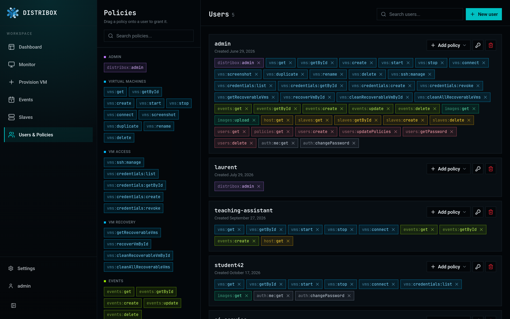
</div>

---

## Wide Range of Operating Systems
Supported out of the box:
- Ubuntu 22.04
- Debian 12
- Fedora 43
- CentOS 10
- AlmaLinux 9
- Alpine Linux 3.21
- Arch Linux (rolling)

---

## Distribox Image Registry
OS images are hosted in a remote S3-based registry. When a VM is created, the backend downloads the corresponding image on demand and caches it locally. This keeps the installation lightweight -- no need to bundle large disk images. Image metadata includes revision tracking so updates are fetched automatically.

### Local images
Bring your own images: click **Upload** in the image picker and choose a qcow2, VMDK, VDI or raw disk, or a zip archive holding one. Distribox converts it, keeps it on the host and lists it next to the registry images. Tick the UEFI option for machines exported from VirtualBox or VMware with EFI enabled.

When provisioning an imported image, choose a **Keyboard Layout** that matches the desktop inside the image. For a French AZERTY desktop such as GLO-2000 Lab, select **French - AZERTY**. Set your default under **Settings** to preselect it for new VMs. Distribox applies supported layouts to QEMU's VNC keyboard translation on each start, including when restoring a saved desktop session. This works without cloud-init or a guest agent. Images that support cloud-init also receive the keyboard setting inside the guest.

**None (VM default)** leaves the existing VNC keymap unchanged. Imported images keep their guest keyboard settings, so selecting a different layout in Distribox requires matching the layout inside the guest as well.

QEMU has no bundled VNC keymap for Latin American Spanish, Romanian, or Korean. These selections leave the existing VNC mapping unchanged while still configuring the guest through cloud-init when the image supports it.

---

## Master / Slave Architecture
Distribox supports a distributed setup where additional machines act as slave nodes. The master coordinates VM placement and proxies operations to slaves. Slaves report resource availability via periodic heartbeats, and the master routes new VMs to the node with the most available memory. The frontend includes a guided tutorial for registering slave nodes.

<div align="center">
  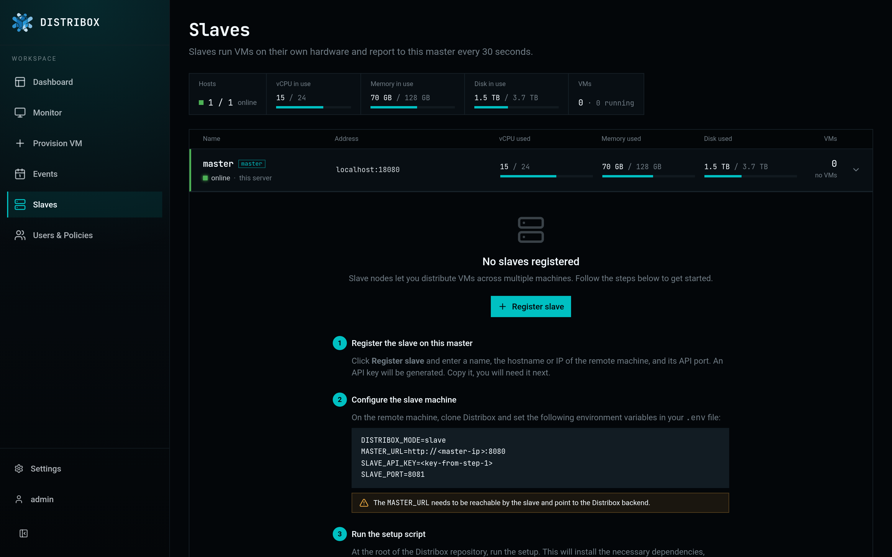
</div>

Once connected, each slave node reports its status and resource usage in realtime.

<div align="center">
  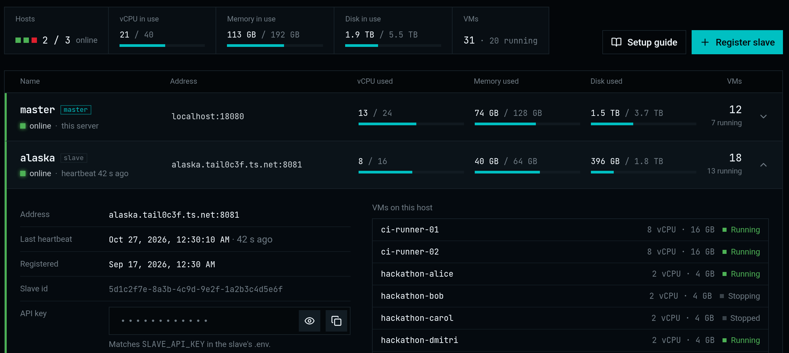
</div>

---

## Realtime Host Metrics
Monitor CPU, memory, and disk usage for the master node, individual slave nodes, or the entire cluster from the dashboard. When provisioning a VM, you can choose which node to deploy on and see its available resources.

<div align="center">
  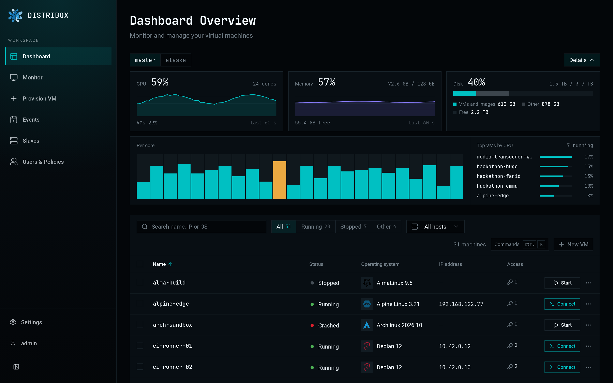
</div>

---

## VM Monitor
The monitor view displays periodical screenshots of all virtual machines on the instance. Running VMs show a live preview, and you can click on any of them to connect directly.

<div align="center">
  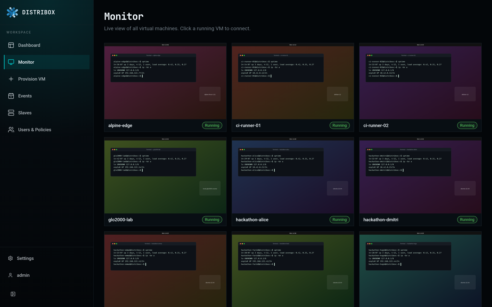
</div>

---

## Events
Events let you distribute a fixed number of VMs with a predefined spec to participants for a set duration. Create an event by choosing an OS, resource allocation, participant limit, and deadline. A shareable link is generated that participants can use to claim their VM.

<div align="center">
  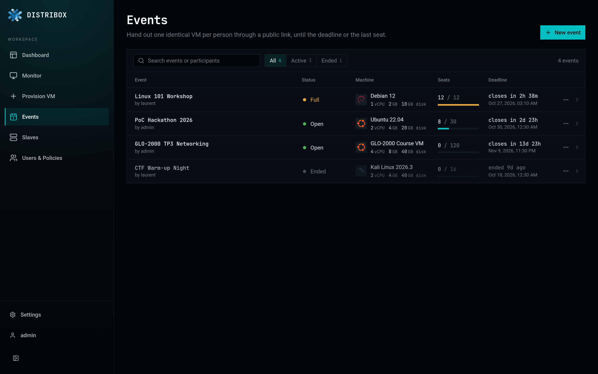
</div>

Each event page shows its details, the provisioned VMs with live previews, and the list of participants.

<div align="center">
  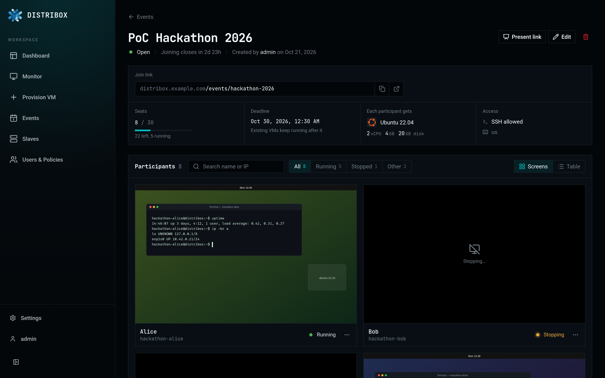
</div>

The share link can be previewed and copied directly from the dashboard.

<div align="center">
  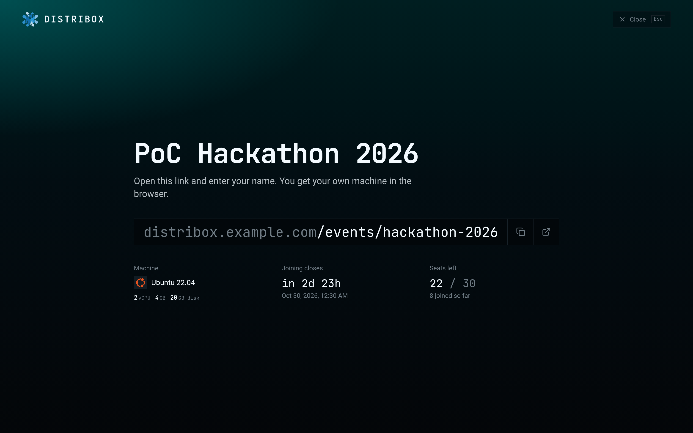
</div>

When an event reaches its deadline, the share link stops working, all VM credentials are revoked, and every virtual machine linked to the event is stopped automatically.

---

## Quickstart

Use an x86_64 Linux host with Docker Engine and the Compose plugin. Run the
installer as your regular user; `bash setup.sh --help` lists its options and
`bash setup.sh --dry-run` shows planned changes. Log out and back in afterward
to apply group memberships. On minimal Alpine installations, install Bash first
with `apk add bash`. On NixOS, the script prints flake integration instructions.

VMs use libvirt's `default` NAT network. Setup preserves it if present; otherwise,
it creates one on `virbr0` with DHCP on `192.168.122.0/24`. SELinux hosts also need
appropriate image-storage labels and a policy allowing the backend to access
the libvirt socket; setup leaves those policies to the administrator.

To keep VM data on another partition, follow the [storage setup](#store-vm-data-on-another-partition) after `setup.sh` and before starting Compose.

```bash
bash setup.sh

cp .env.example .env

docker compose --profile master up -d --build
```

The application will be available at `localhost:3000`.

For development with hot-reloading:

```bash
docker compose --profile dev up --build
```

To run a slave node on another machine, follow the guide on the **Slaves** page of the dashboard. It ends with:

```bash
docker compose --profile slave up -d
```

### Store VM data on another partition

Use `/data` for VM disks and downloaded images by bind-mounting `/data/distribox` at `/var/lib/distribox` **on the host**. Docker and libvirt then share the same files, and existing VM paths still work.

Keep the Compose volume `/var/lib/distribox:/var/lib/distribox` unchanged.

<details>
<summary>Set up storage on /data</summary>

Requires Linux with systemd, Docker Engine, `rsync`, and `/data` mounted through `/etc/fstab`. Run `setup.sh` and configure `.env` first. Back up existing data, and continue only when each command succeeds.

1. **Check the disk.** Confirm `/data` is mounted and has room for the copy:

   ```bash
   findmnt --mountpoint /data
   df -h /data
   sudo du -sh /var/lib/distribox
   ```

   Stop if `/data` is not mounted. This guide assumes `/var/lib/distribox` is an ordinary directory, without custom mounts or storage pools. The destination and backup directories used below must not already exist.

2. **Stop the backend and VMs.** Shut down each Distribox VM and wait until all report `shut off`. Stopping Docker does **not** stop host VMs.

   ```bash
   docker compose --profile master stop backend
   sudo virsh -c qemu:///system list --all
   sudo virsh -c qemu:///system shutdown VM_ID
   ```

   Replace `VM_ID` for each VM. Resume paused VMs before shutting them down.

3. **Copy the data.** These flags preserve sparse disks and file permissions:

   ```bash
   sudo mkdir /data/distribox
   sudo rsync -aHAXS --numeric-ids /var/lib/distribox/ /data/distribox/
   sudo rsync -aHAXScn --numeric-ids --itemize-changes /var/lib/distribox/ /data/distribox/
   ```

   The last command verifies the copy and should print nothing. Fix any errors or differences before moving the original aside:

   ```bash
   sudo mv -T /var/lib/distribox /var/lib/distribox.before-storage-move
   sudo install -d -m 755 /var/lib/distribox
   ```

4. **Mount at boot.** Back up `/etc/fstab`, then add:

   ```fstab
   /data/distribox /var/lib/distribox none bind,x-systemd.requires=data.mount 0 0
   ```

   Run `sudo systemctl edit docker.service` and `sudo systemctl edit libvirtd.service`. Add this to both:

   ```ini
   [Unit]
   Requires=var-lib-distribox.mount
   After=var-lib-distribox.mount
   ```

   This makes both services wait for storage. A missing mount blocks them, including their other workloads. Keep `nofail` off these storage mounts.

5. **Mount and restart.**

   ```bash
   sudo findmnt --verify --verbose
   sudo systemctl daemon-reload
   sudo systemctl start var-lib-distribox.mount
   df -h /data /var/lib/distribox
   docker compose --profile master up -d --force-recreate backend
   docker compose --profile master exec backend df -h /var/lib/distribox
   ```

   Host and container should now report the data partition's capacity. Recreating the backend is necessary: an old container can retain its previous mount. For a fresh install, also start the full application using the Quickstart command.

Check your files and start a VM before removing `/var/lib/distribox.before-storage-move`. That backup still occupies space on the system disk. Verify the mounts after the next reboot.

</details>

<details>
<summary>Other setups and rollback</summary>

- **Development or slave:** use profile/service `dev`/`backend-dev` or `slave`/`slave` in the Compose commands.
- **Modular libvirt:** edit `virtqemud.service` instead of `libvirtd.service`.
- **Different mount path:** replace `/data` and find its unit name with `systemd-escape --path --suffix=mount /your/path`.
- **Custom security policies:** preserve file labels and resolve AppArmor or SELinux denials through the host policy. Do not use world-writable permissions.

To roll back, stop the backend and all Distribox VMs, then stop `var-lib-distribox.mount`. This also stops Docker and libvirt, so plan downtime for the whole host. Remove the fstab line and the service override lines added above, then reload systemd. Use `rmdir` on the empty mount point, restore the backup to `/var/lib/distribox`, restart services, and recreate the backend. If data changed after migration, copy the current data back while everything is stopped; the backup is stale.

[Mount dependencies](https://www.freedesktop.org/software/systemd/man/latest/systemd.mount.html) · [Docker bind mounts](https://docs.docker.com/engine/storage/bind-mounts/)

</details>

## Configuration

Copy `.env.example` to `.env` and adjust as needed. Key variables:

| Variable | Default | Description |
|----------|---------|-------------|
| `DISTRIBOX_MODE` | `master` | `master` or `slave` |
| `MASTER_URL` | - | URL of the master (slave mode only) |
| `SLAVE_API_KEY` | - | API key for slave authentication |
| `ADMIN_USERNAME` | `admin` | Default admin username |
| `ADMIN_PASSWORD` | `admin` | Default admin password |
| `DISTRIBOX_SECRET` | `secret` | Encryption key for sensitive data |
| `JWT_SECRET_KEY` | derived | JWT signing key, derived from `DISTRIBOX_SECRET` when empty |
| `BACKEND_PORT` | `8080` | Backend API port |
| `VITE_PORT` | `3000` | Frontend port |
| `VITE_API_DOMAIN` | `http://localhost:8080` | Backend URL as seen from the browser |
| `VITE_TUNNEL_URL` | - | WebSocket URL for VM streaming, defaults to `VITE_API_DOMAIN` + `/tunnel` |
| `FRONTEND_URL` | `http://localhost:3000` | Frontend URL, used for CORS |
| `ROOT_PATH` | - | Path prefix the reverse proxy serves the API under, `/api` with the provided `nginx.conf` |
| `VIRT_TYPE` | `kvm` | `kvm`, or `qemu` for software emulation |
| `GLISS_IN_FLIGHT_FRAMES` | `8` | Maximum frames awaiting browser presentation ACKs, from 1 to 8 |
| `GLISS_FPS` | `30` | Capture frame-rate cap, from 1 to 60 |
| `GLISS_H264_BITRATE` | `2000000` | Soft H.264 encoder target, 1000–50000000 bits/second; actual traffic can exceed it |
| `SSH_*` | disabled | See [SSH gateway](#ssh-gateway) |

`VITE_*` values are baked into the frontend at build time. After changing them, rebuild it with `docker compose --profile master up -d --build frontend`.

Gliss settings apply on the host running the VM. After editing `.env`, recreate the relevant backend container with `docker compose up -d backend` (master) or `docker compose up -d slave` (slave); `docker compose restart` keeps the old environment. Restart the process when running the backend manually. Eight in-flight frames keep 30 fps possible with roughly 250 ms of combined network and browser decode/paint delay. Use a smaller window, such as 4, to limit queued frames on constrained links. Lower `GLISS_FPS` or `GLISS_H264_BITRATE` when actual video traffic exceeds available bandwidth; the bitrate target is not a hard network cap. The backend Docker commands disable WebSocket deflate to avoid recompressing H.264. When launching the backend manually, use `uvicorn app.main:app --host 0.0.0.0 --port 8080 --ws-per-message-deflate false` from `backend/`.

Update slave backends before the master when upgrading desktop streaming. The master requires the slave's `/vms/{vm_id}/desktop/tunnel` WebSocket endpoint; older slaves cannot stream through an updated master. Master-to-slave streaming uses the existing API port and `X-Slave-Token` over the trusted private network. The master retains viewer authorization and resize ownership.

Existing slave VMs may listen only on the private address previously used by the master. Set the slave's `VNC_HOST` to that existing listen address before upgrading; Gliss still connects on the same host. Changing `VNC_LISTEN` or restarting the backend does not rewrite existing VM definitions. Move their VNC listeners to loopback during a planned VM restart, or keep `VNC_HOST` pointed at their current listener. `VNC_LISTEN=127.0.0.1` applies to newly defined VMs.

## Deployment

### Reverse Proxy (nginx)

In production, you should place nginx in front of the application to serve both the frontend and backend on a single port. A ready-to-use configuration is provided in [`nginx.conf`](./nginx.conf).

Install it:

```bash
sudo cp nginx.conf /etc/nginx/sites-available/distribox
sudo ln -s /etc/nginx/sites-available/distribox /etc/nginx/sites-enabled/
sudo nginx -t && sudo systemctl reload nginx
```

This configuration:
- Listens on port **80** and routes traffic to the frontend (port 3000) and backend (port 8080)
- Serves the backend API under `/api`, stripping the prefix (`/api/vms/` reaches `/vms/`)
- Proxies WebSocket connections for VM streaming (`/api/tunnel`)
- Sends every other path to the frontend

> Note: If you change port configuration for the deployment, we trust you will update the reverse proxy configuration accordingly.

After enabling the reverse proxy, update your `.env` so the frontend calls the backend through nginx instead of directly, and the API docs load at `/api/docs` and `/api/redoc`:

```env
VITE_API_DOMAIN=http://your-domain.com/api
FRONTEND_URL=http://your-domain.com
ROOT_PATH=/api
```

### Firewall

VNC servers listen on ports 5900-5999 on the host. These must **not** be exposed to the network -- VM streaming is handled through the backend's authenticated WebSocket tunnel. Keep `VNC_LISTEN` and `VNC_HOST` on loopback, including on slave nodes: each host encodes its own desktops. Block remote VNC access with your firewall:

```bash
# ufw
sudo ufw deny 5900:5999/tcp

# or iptables
sudo iptables -A INPUT -p tcp --dport 5900:5999 -j DROP
```

### SSH gateway

Set these values in `.env`, then rebuild the backend:

```env
SSH_ENABLED=true
SSH_PORT=2222
SSH_PUBLIC_HOST=distribox.example.com
```

`SSH_PUBLIC_HOST` is the hostname recipients connect to; it defaults to the hostname in `FRONTEND_URL`. Set `SSH_PUBLIC_PORT` only when an external port mapping differs from `SSH_PORT`. The backend uses host networking to reach guests behind libvirt NAT; it listens directly on the configured API and SSH ports. Allow the SSH TCP port through the host firewall; the HTTP reverse proxy does not carry native SSH traffic. The default database hostname is mapped to localhost inside backend containers, where Compose publishes PostgreSQL. Custom database hostnames continue to work.

SSH requires a unique `DISTRIBOX_SECRET` of at least 32 characters on the master and each slave serving SSH VMs. For a new installation, generate one with `openssl rand -hex 32`. Keep existing encryption secrets when upgrading: replacing `DISTRIBOX_SECRET` makes previously encrypted credentials unreadable. Back up `/var/lib/distribox/ssh/host_key`, the per-VM directories, and the encryption secret. The persistent gateway key keeps the fingerprint stable across restarts.

Guests need OpenSSH server, the `user` account, a running QEMU guest agent with `guest-exec` enabled, and an IPv4 DHCP lease on a libvirt-managed network. Updated image builders include OpenSSH. For older or custom images, install OpenSSH and install and enable the QEMU guest agent through the web client first. The guest agent must run as root and have the `org.qemu.guest_agent.0` virtio channel. Images using a different login account need the `user` account provisioned before SSH can be prepared.

Enabling **Allow SSH** on a running VM prepares its key and configuration, enables the SSH service at boot, and reloads or starts it through systemd or OpenRC. Each explicit enable refreshes this setup, even if a previous connection was prepared recently. Setup failures leave access disabled and report the missing prerequisite. Enabling it on a stopped VM saves the preference and reports that setup is pending; the first SSH connection after startup prepares the guest. VMs enabled through an event also use preparation on their first connection.

Guest setup disables password and root SSH login and verifies guest host keys through the guest agent. Guest keys stay on the server; the browser receives no private key or guest password. The web console login is unchanged.

Slave connections use the existing authenticated management API and a private WebSocket relay. Update slave backends before enabling SSH through an updated master: older slaves cannot confirm that they applied the forced preparation. Keep master-to-slave traffic on a trusted, isolated network or an encrypted network tunnel: the current management API uses HTTP and carries both its API token and SSH preparation secrets. Only the master's SSH gateway port needs to be publicly reachable.

New event and VM access secrets use 32 random bytes. Credential IDs alone no longer authorize web connections; share links must contain the access secret. JWT signing now derives a separate signing key from `DISTRIBOX_SECRET` unless `JWT_SECRET_KEY` is explicitly set. Users with sessions signed by the previous default key must log in again. An explicit JWT key must also contain at least 32 characters when SSH is enabled.

### SSL is STRONGLY RECOMMENDED

Distribox should be served over HTTPS. Without SSL:

- Automatic clipboard reads and writes require the [Clipboard API in a secure context](https://developer.mozilla.org/en-US/docs/Web/API/Clipboard_API#security_considerations). Browsers can also require permission or a user gesture. Use the **Clipboard** dialog for manual text transfer when this API is unavailable.

The easiest way to set up SSL is with [Certbot](https://certbot.eff.org/) (Let's Encrypt):

```bash
sudo apt install certbot python3-certbot-nginx
sudo certbot --nginx -d your-domain.com
```

Certbot will automatically modify your nginx configuration to:
- Redirect HTTP (port 80) to HTTPS (port 443)
- Install and renew your TLS certificate

After running Certbot, update your `.env`:

```env
VITE_API_DOMAIN=https://your-domain.com/api
FRONTEND_URL=https://your-domain.com
```

Certbot sets up automatic renewal via a systemd timer. You can verify it with:

```bash
sudo certbot renew --dry-run
```

## Tech Stack

- **Backend:** FastAPI, SQLModel, PostgreSQL, libvirt, KVM/QEMU
- **Frontend:** React Router v7, TypeScript, TailwindCSS v4, shadcn/ui
- **Streaming:** [gliss](https://github.com/lg-epitech/gliss) over WebSocket
- **Containerization:** Docker Compose

## Get Involved

Check out the [contributing guide](./CONTRIBUTING.md).

If you're interested in how the project is organized at a higher level, contact the current project manager.

### Further Documentation

- [Backend](./backend/README.md) -- environment setup and standalone backend configuration
- [Frontend](./frontend/README.md) -- environment setup and standalone frontend configuration
- [Images](./images/README.md) -- guide for building and customizing OS images
- [Atlas](./atlas/README.md) -- syncing tool to upload images to the Distribox registry

## Our PoC team ❤️

Developers
| [<br><sub>Loan Riyanto</sub>](https://github.com/skl1017)
| :---: |

### Manager
| [<br><sub>Laurent Gonzalez</sub>](https://github.com/lg-epitech) |
| :---: |

<h2 align=center>
Organization
</h2>

<p align='center'>
    <a href="https://www.linkedin.com/company/pocinnovation/mycompany/">
        
    </a>
    <a href="https://www.instagram.com/pocinnovation/">
        
    </a>
    <a href="https://twitter.com/PoCInnovation">
        
    </a>
    <a href="https://discord.com/invite/Yqq2ADGDS7">
        
    </a>
</p>
<p align=center>
    <a href="https://www.poc-innovation.fr/">
        
    </a>
</p>

> 🚀 Don't hesitate to follow us on our different networks, and put a star 🌟 on `PoC's` repositories

> Made with ❤️ by PoC
